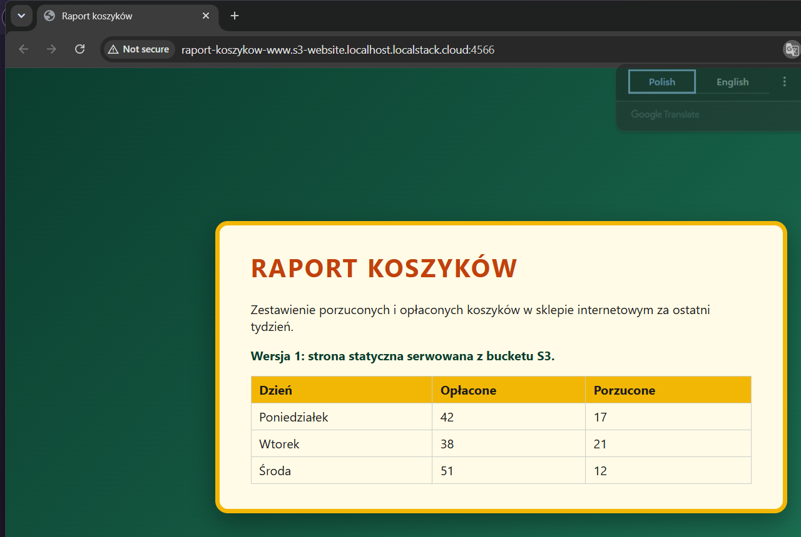
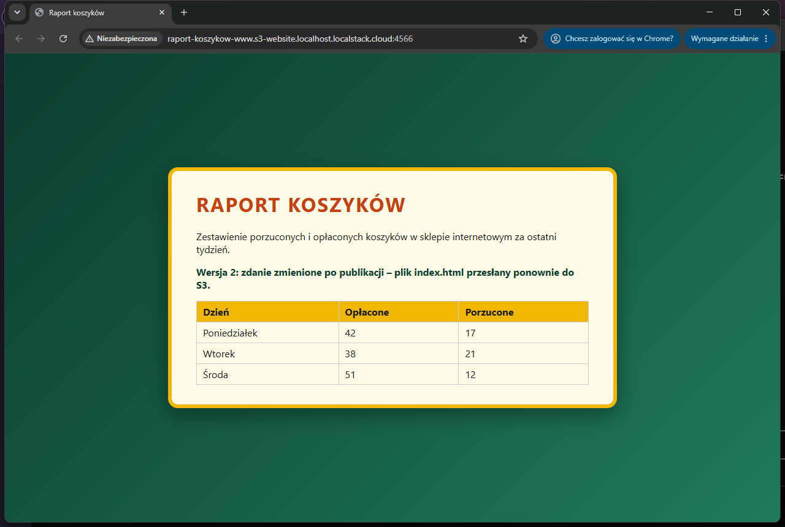
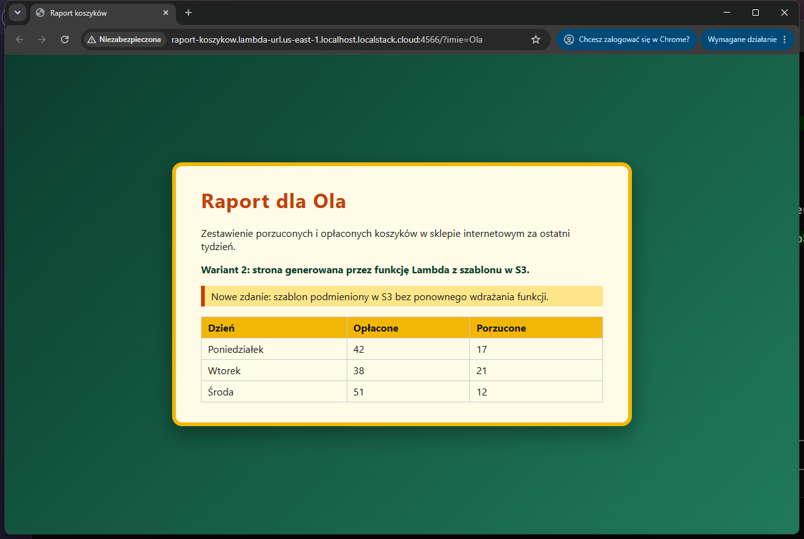
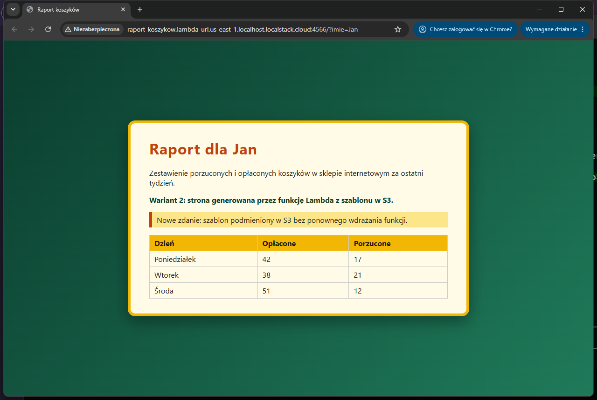
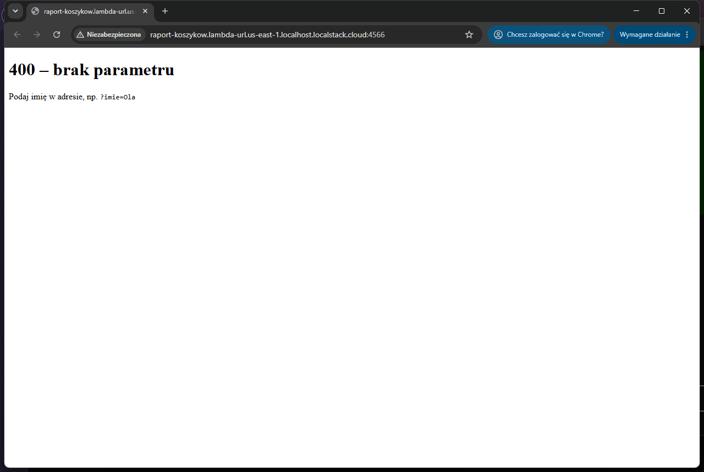

# Lab 2 – Jedna strona, dwa sposoby udostępnienia

**Autor:** Marek Jancevic · **Data:** 2026-11-17
**Środowisko:** LocalStack `2026.10.7` w Docker Compose (Docker Desktop / WSL2, Windows 11), `lstk 1.4.5`, AWS CLI 1.46

Pełny zapis poleceń i wyników z terminala: [`polecenia-lstk.txt`](polecenia-lstk.txt).

## Zasoby

| Rodzaj | Nazwa | Adres |
|---|---|---|
| Bucket S3 (strona statyczna) | `raport-koszykow-www` | http://raport-koszykow-www.s3-website.localhost.localstack.cloud:4566/ |
| Bucket S3 (szablon, domyślny dostęp) | `raport-koszykow-szablony` | obiekt `template.html` |
| Funkcja Lambda (Python 3.12) | `raport-koszykow-fn` (handler `handler.lambda_handler`) | http://raport-koszykow.lambda-url.us-east-1.localhost.localstack.cloud:4566/ |

## Pliki w repozytorium

| Plik | Opis |
|---|---|
| `compose.yaml` | LocalStack, porty tylko na `127.0.0.1`, montowany `/var/run/docker.sock` (wymagany, bo Lambda w LocalStack uruchamia funkcje w osobnych kontenerach Dockera), token z `.env` |
| `.gitignore`, `.env.example` | `.env` z `LOCALSTACK_AUTH_TOKEN` jest lokalny i nie trafia do repozytorium |
| `www/index.html`, `www/style.css` | strona statyczna |
| `bucket-policy.json` | polityka bucketu: publiczny odczyt (`s3:GetObject`) plików strony |
| `lambda/handler.py` | kod funkcji (jedyna zawartość paczki `funkcja.zip`) |
| `szablon/template.html` | końcowa wersja szablonu (z CSS w środku i `{{IMIE}}` w nagłówku) |
| `scripts/run.sh`, `scripts/zrzut.py` | pomocnicze: zapis poleceń do logu, zrzuty okna przeglądarki |

## 1. Uruchomienie środowiska

```powershell
npm install -g @localstack/lstk      # CLI LocalStack
pip install awscli                   # AWS CLI (lstk aws go wywołuje)
lstk login                           # logowanie do konta LocalStack (plan Hobby/Trial)
# .env:  LOCALSTACK_AUTH_TOKEN=ls-...  (plik w .gitignore)
docker compose up -d
docker compose ps                    # localstack-main  Up (healthy)  127.0.0.1:4566->4566/tcp
curl http://localhost:4566/_localstack/info   # "version": "2026.10.7", "is_license_activated": true
```

Wszystkie polecenia AWS są kierowane do emulatora przez `lstk aws ...` (odpowiednik
`aws --endpoint-url http://localhost.localstack.cloud:4566 ...` z kluczami `test/test`, region `us-east-1`).

## 2. Wariant 1 – S3 Website

```bash
lstk aws s3 mb s3://raport-koszykow-www
lstk aws s3 cp www/index.html s3://raport-koszykow-www/index.html --content-type "text/html; charset=utf-8"
lstk aws s3 cp www/style.css  s3://raport-koszykow-www/style.css  --content-type "text/css; charset=utf-8"
lstk aws s3 website s3://raport-koszykow-www --index-document index.html
lstk aws s3api put-bucket-policy --bucket raport-koszykow-www --policy file://bucket-policy.json
```

Zmiana stylu łatwa do zauważenia: zielone tło z gradientem, karta z żółtą ramką, pomarańczowy nagłówek wielkimi literami.

Pierwsza publikacja (zdanie „Wersja 1: …”):



Zmiana jednego zdania w `www/index.html` → „Wersja 2: zdanie zmienione po publikacji – plik index.html przesłany ponownie do S3.” i ponowne przesłanie:

```bash
lstk aws s3 cp www/index.html s3://raport-koszykow-www/index.html --content-type "text/html; charset=utf-8"
```

Ten sam adres, widoczny styl CSS i zmienione zdanie:



```
$ curl -s -i http://raport-koszykow-www.s3-website.localhost.localstack.cloud:4566/
HTTP/1.1 200 OK
Content-Type: text/html; charset=utf-8
...
    <p id="zdanie">Wersja 2: zdanie zmienione po publikacji – plik index.html przesłany ponownie do S3.</p>

$ curl ... /style.css
style.css -> HTTP 200, text/css; charset=utf-8
```

## 3. Wariant 2 – Lambda Function URL

Szablon w osobnym buckecie (bez polityki i bez website – ustawienia domyślne):

```bash
lstk aws s3 mb s3://raport-koszykow-szablony
lstk aws s3 cp szablon/template.html s3://raport-koszykow-szablony/template.html --content-type "text/html; charset=utf-8"
```

Wdrożenie funkcji (w paczce tylko kod – `handler.py`; szablon zostaje w S3):

```bash
# build/funkcja.zip = [handler.py]
lstk aws lambda create-function --function-name raport-koszykow-fn \
  --runtime python3.12 --handler handler.lambda_handler \
  --role arn:aws:iam::000000000000:role/lambda-role \
  --zip-file fileb://build/funkcja.zip \
  --environment "Variables={TEMPLATE_BUCKET=raport-koszykow-szablony,TEMPLATE_KEY=template.html}" \
  --tags '{"_custom_id_":"raport-koszykow"}' --timeout 15
lstk aws lambda wait function-active-v2 --function-name raport-koszykow-fn
lstk aws lambda create-function-url-config --function-name raport-koszykow-fn --auth-type NONE
lstk aws lambda add-permission --function-name raport-koszykow-fn --statement-id publiczny-url \
  --action lambda:InvokeFunctionUrl --principal "*" --function-url-auth-type NONE
```

Tag `_custom_id_` daje w LocalStack stały adres `raport-koszykow.lambda-url...` zamiast losowego identyfikatora.

Działanie funkcji (`lambda/handler.py`):
- czyta `event["queryStringParameters"]["imie"]`; brak lub pusta wartość → **400** z podpowiedzią `?imie=Ola`,
- pobiera `template.html` z S3 (boto3; w LocalStack endpoint jest wstrzykiwany przez `AWS_ENDPOINT_URL`) **przy każdym żądaniu**,
- podstawia `html.escape(imie)` w miejsce `{{IMIE}}` – znaki specjalne wyświetlają się jako tekst,
- zwraca **200** i `Content-Type: text/html; charset=utf-8`.

### Zrzuty – Ola i Jan

Oba zrzuty wykonane **po** podmianie szablonu – widać dodane później zdanie
„Nowe zdanie: szablon podmieniony w S3 bez ponownego wdrażania funkcji.” (żółte tło).
Podmieniony został obiekt **`s3://raport-koszykow-szablony/template.html`**; funkcja nie była wdrażana ponownie.





Adres bez parametru – HTTP 400:



## 4. Odpowiedzi HTTP i źródło HTML

**200 + Content-Type** (przed podmianą szablonu):

```
$ curl -s -i "http://raport-koszykow.lambda-url.us-east-1.localhost.localstack.cloud:4566/?imie=Ola"
HTTP/1.1 200 OK
Content-Type: text/html; charset=utf-8
    <h1>Raport dla Ola</h1>
    <p id="zdanie">Wariant 2: strona generowana przez funkcję Lambda z szablonu w S3.</p>

$ curl -s -i ".../?imie=Jan"
HTTP/1.1 200 OK
Content-Type: text/html; charset=utf-8
    <h1>Raport dla Jan</h1>
```

**400 z komunikatem** (bez parametru oraz z pustym `?imie=`):

```
$ curl -s -i http://raport-koszykow.lambda-url.us-east-1.localhost.localstack.cloud:4566/
HTTP/1.1 400 BAD REQUEST
Content-Type: text/html; charset=utf-8
Content-Length: 147

<!DOCTYPE html><html lang="pl"><meta charset="utf-8"><h1>400 – brak parametru</h1><p>Podaj imię w adresie, np. <code>?imie=Ola</code></p></html>
```

**Znaki specjalne jako tekst:**

```
$ curl -s ".../?imie=%3Cscript%3Ealert(1)%3C%2Fscript%3E%20%26%20%22Ola%22" | grep "<h1>"
    <h1>Raport dla &lt;script&gt;alert(1)&lt;/script&gt; &amp; &quot;Ola&quot;</h1>
```

**Podmiana szablonu bez ponownego wdrożenia** – `LastModified`/`CodeSha256` funkcji przed i po są identyczne,
a odpowiedź zawiera nowe zdanie:

```
$ lstk aws lambda get-function --function-name raport-koszykow-fn --query "Configuration.[LastModified,CodeSha256]" --output text
2026-11-17T15:56:49.125+0000	PzAiOp3afwREqwlOpnlDInmcm0evpYM0hYe538cOtzw=
$ lstk aws s3 cp szablon/template.html s3://raport-koszykow-szablony/template.html --content-type "text/html; charset=utf-8"
upload: szablon\template.html to s3://raport-koszykow-szablony/template.html
$ curl -s -i ".../?imie=Ola"
HTTP/1.1 200 OK
Content-Type: text/html; charset=utf-8
    <h1>Raport dla Ola</h1>
    <p class="nowe">Nowe zdanie: szablon podmieniony w S3 bez ponownego wdrażania funkcji.</p>
$ lstk aws lambda get-function --function-name raport-koszykow-fn --query "Configuration.[LastModified,CodeSha256]" --output text
2026-11-17T15:56:49.125+0000	PzAiOp3afwREqwlOpnlDInmcm0evpYM0hYe538cOtzw=
```

**Obiekt odczytany z S3 – nadal zawiera `{{IMIE}}`:**

```
$ lstk aws s3 cp s3://raport-koszykow-szablony/template.html build/template-z-s3.html
download: s3://raport-koszykow-szablony/template.html to build\template-z-s3.html
$ grep -n -E "IMIE|nowe\">" build/template-z-s3.html
36:    <h1>Raport dla {{IMIE}}</h1>
39:    <p class="nowe">Nowe zdanie: szablon podmieniony w S3 bez ponownego wdrażania funkcji.</p>
```

Funkcja podstawia imię tylko w odpowiedzi – obiekt w S3 się nie zmienia.

> Uwaga: LocalStack domyślnie nie egzekwuje uprawnień IAM (`ENFORCE_IAM=0`), więc anonimowy
> odczyt `template.html` z bucketu z domyślnymi ustawieniami też zwraca 200. W prawdziwym AWS ten
> bucket jest prywatny (Block Public Access) i tylko rola funkcji z `s3:GetObject` może czytać szablon.

## 5. Wniosek

- **Kto dostarcza HTML.** W wariancie S3 Website HTML dostarcza bezpośrednio **S3** – zwraca zapisany plik
  `index.html` (i `style.css`) bajt w bajt, bez wykonywania żadnego kodu. W wariancie Function URL HTML
  dostarcza **funkcja Lambda** – przy każdym żądaniu pobiera szablon z S3, podstawia parametr i sama
  buduje odpowiedź (status, nagłówki, treść).
- **Kiedy wystarczy strona statyczna.** Gdy treść jest taka sama dla każdego odwiedzającego i zmienia się
  tylko przez ponowne wgranie plików (wizytówka, dokumentacja, raport wygenerowany wcześniej, frontend SPA).
  Jest tańsza, szybsza, prostsza i nie ma kodu, który mógłby zawieść; nie da się w niej jednak reagować
  na parametry żądania, walidować wejścia ani zwracać różnych kodów HTTP.
- **Po co szablon osobno od kodu.** Wygląd i treść strony można zmieniać przez podmianę obiektu w S3,
  **bez ponownego wdrażania funkcji** (pokazane wyżej: ten sam `CodeSha256`, nowe zdanie widoczne po
  odświeżeniu). Rozdziela to odpowiedzialności – kto inny może edytować HTML, a kto inny kod; paczka
  wdrożeniowa jest mała, S3 przechowuje historię/wersje szablonu, a ten sam kod może obsługiwać wiele
  szablonów (np. inny `TEMPLATE_KEY`).
